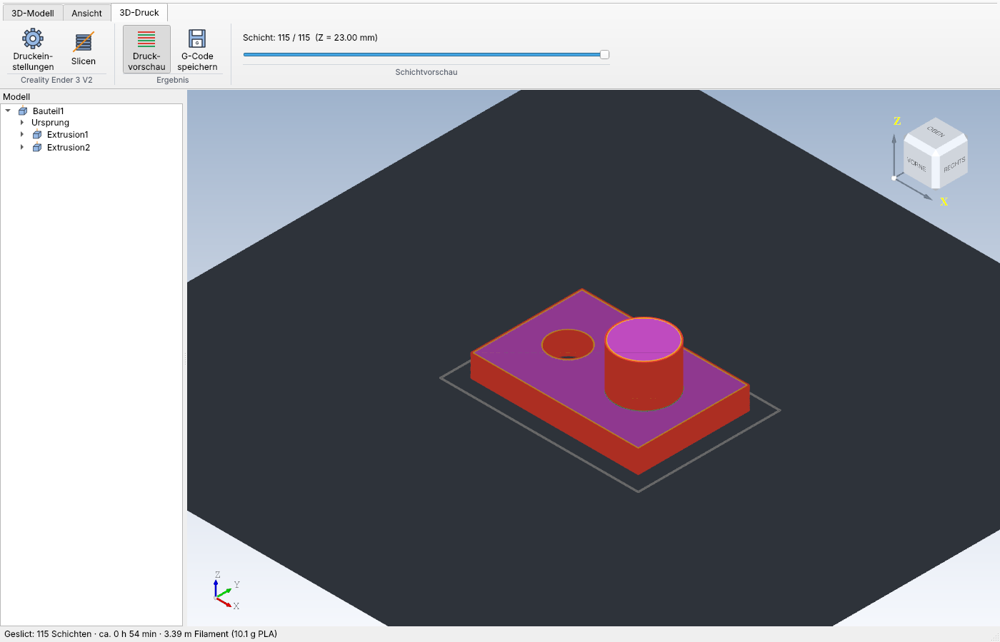

# FormWerk

Parametrisches 3D-CAD für den 3D-Druck, in der Bedienung an Autodesk Inventor angelehnt,
mit integriertem Slicer für den **Creality Ender 3 V2** (220 × 220 × 250 mm, 0,4-mm-Düse, Marlin).

Technik: C++17, Qt 6 (Oberfläche), OpenCascade (CAD-Kernel), Clipper (2D-Polygone im Slicer).




## Stand (Version 0.1)

**Modellieren**
- Multifunktionsleiste mit den Registern *3D-Modell*, *Ansicht* und *3D-Druck*
- Modellbrowser mit Feature-Baum: Doppelklick bearbeitet, Rechtsklick bietet Unterdrücken und Löschen
- 2D-Skizzen auf XY-, XZ- oder YZ-Ebene (mit Abstand), Elemente: Rechteck, Kreis, über Maße bearbeitbar
- Extrusion (Verbinden, Differenz, Schnittmenge, symmetrisch), Drehung um eine Skizzenachse
- Parametrische Neuberechnung: Maß ändern, Modell baut sich neu auf
- ViewCube, Ausgangsansicht (F6), Standardansichten, STL-Export

**Slicer (Ender 3 V2)**
- Wände, Boden- und Deckschichten, Linien-Infill (abwechselnd ±45°), Skirt
- Rückzug (Bowden, 5 mm), Lüfter ab Schicht 2, Start-/End-G-Code mit Reinigungslinie
- Alle Einstellungen in Gruppen (Qualität, Wände, Deck/Boden, Füllung, Geschwindigkeit, Temperatur,
  Kühlung, Rückzug, Haftung, Material, Maschine inkl. Start-/End-G-Code), mit einfacher und Experten-Ansicht
- Druckprofile: 4 mitgelieferte (PLA Standard/Fein/Schnell, PETG), eigene speichern, importieren, exportieren (`.fwprofile`)
- Höhen-Ereignisse: Pause (Kopf parken, M0), Filamentwechsel (M600), Düsen-/Betttemperatur, Lüfter,
  Geschwindigkeit, Fluss oder eigener G-Code ab einer Höhe; direkt aus der Schichtvorschau einfügbar
- Brim, Gitter- oder Linien-Füllung, Z-Naht hinten, eigene Temperaturen für die erste Schicht
- Schätzung von Druckzeit, Filamentlänge, Gewicht und Kosten
- Farbige Schichtvorschau auf dem Druckbett, Druckzeit- und Filamentschätzung
- G-Code mit `;LAYER:` / `;TYPE:`-Kommentaren (kompatibel mit gängigen G-Code-Viewern)

**Tastenkürzel:** S Skizze · E Extrusion · R Drehung · F6 Ausgangsansicht · Strg+R Slicen · Strg+G G-Code speichern

**Maus:** Rad = Zoom · Mittlere Taste = Verschieben · Umschalt+Mitte oder Rechts = Drehen

## Nächste Schritte

1. Echter Skizzen-Modus: Linien, Bögen, Abhängigkeiten (horizontal, vertikal, parallel, koinzident) mit Solver
2. Skizzen auf Bauteilflächen, Bohrung, Fase/Rundung
3. Speichern/Laden im eigenen Dateiformat
4. Slicer: automatische Stützen, danach Modifikator-Körper (Infill-Zonen, Stützen erzwingen/sperren)

## Programm unter Windows 10 holen

Ohne selbst zu kompilieren: Auf GitHub unter **Actions → Windows-Build** den letzten erfolgreichen
Lauf öffnen und das Artefakt **FormWerk-Windows** herunterladen, entpacken, `formwerk.exe` starten.
Der allererste Lauf dauert lange (Qt und OpenCascade werden einmalig gebaut), danach geht es schnell.

## Selbst bauen unter Windows 10

1. [Visual Studio 2022 Community](https://visualstudio.microsoft.com/de/) mit der Workload „Desktopentwicklung mit C++" installieren
2. vcpkg einrichten (einmalig):
   ```powershell
   git clone https://github.com/microsoft/vcpkg C:\vcpkg
   C:\vcpkg\bootstrap-vcpkg.bat
   ```
3. Bauen (in der „Developer PowerShell for VS 2022"):
   ```powershell
   cmake -S . -B build -G "Visual Studio 17 2022" -A x64 -DCMAKE_TOOLCHAIN_FILE=C:\vcpkg\scripts\buildsystems\vcpkg.cmake
   cmake --build build --config Release
   build\Release\formwerk.exe
   ```
   vcpkg lädt und baut Qt, OpenCascade und Clipper automatisch (`vcpkg.json`). Das erste Mal dauert das 1–2 Stunden.

## Bauen unter Linux (Ubuntu/Debian)

```bash
sudo apt install cmake g++ qt6-base-dev libgl-dev libtbb-dev libpolyclipping-dev \
  libocct-modeling-algorithms-dev libocct-modeling-data-dev libocct-visualization-dev \
  libocct-data-exchange-dev libocct-foundation-dev
cmake -S . -B build && cmake --build build -j
./build/formwerk_tests && ./build/formwerk
```

## Aufbau

```
src/core/     Skizzen, Features (Extrusion, Drehung), Bauteil mit Neuberechnung
src/slicer/   Triangulierung, Schichtkonturen, Wände/Infill (Clipper), Marlin-G-Code
src/app/      Qt-Oberfläche: Multifunktionsleiste, Modellbrowser, OpenCascade-3D-Ansicht
tests/        Tests für Modellierung und Slicer
```
