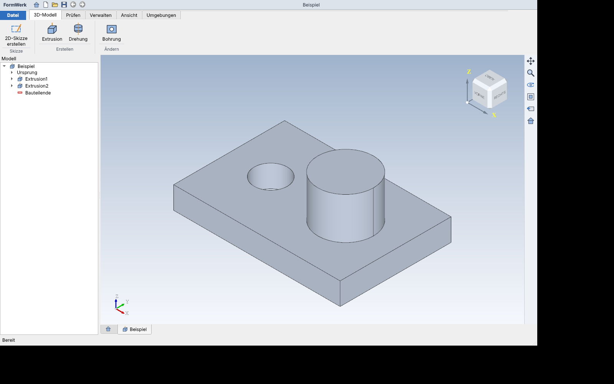
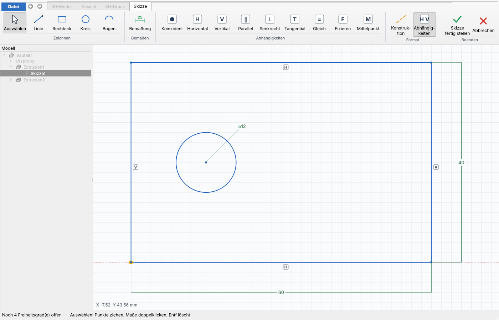
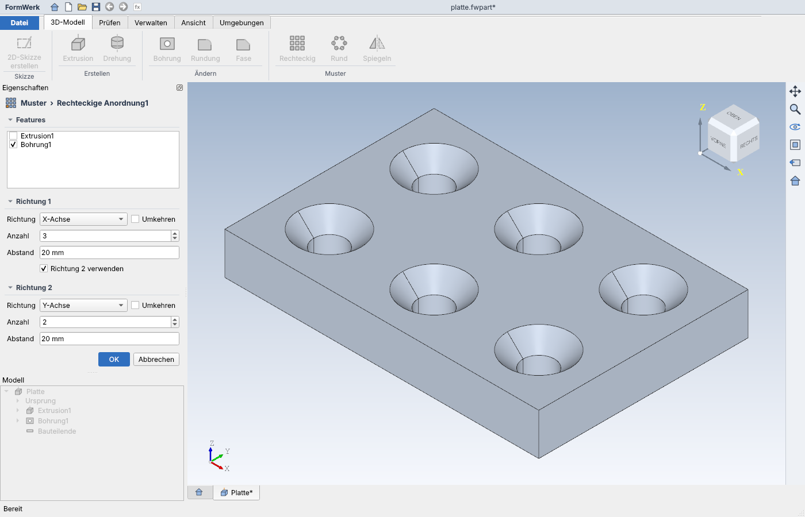

# FormWerk

Parametrisches 3D-CAD für den 3D-Druck, in der Bedienung an Autodesk Inventor angelehnt,
mit integriertem Slicer für den **Creality Ender 3 V2** (220 × 220 × 250 mm, 0,4-mm-Düse, Marlin).

Technik: C++17, Qt 6 (Oberfläche), OpenCascade (CAD-Kernel), Clipper (2D-Polygone im Slicer).






## Stand (Version 0.1)

**Allgemein**
- Datei-Menü: Neu, Öffnen, Zuletzt geöffnet, Speichern (unter) im eigenen Format `.fwpart`
- Rückgängig/Wiederholen (Strg+Z / Strg+Y) für alle Modelländerungen
- Slicen im Hintergrund mit Fortschrittsanzeige und Abbrechen

**Modellieren**
- Multifunktionsleiste mit den Registern *3D-Modell*, *Ansicht* und *3D-Druck*
- Modellbrowser mit Feature-Baum: Doppelklick bearbeitet, Rechtsklick bietet Unterdrücken und Löschen
- **Skizzenmodus**: Linie (Linienzug), Rechteck, Kreis, Bogen mit der Maus zeichnen, Fangen an vorhandenen Punkten,
  automatische Horizontal-/Vertikal-Abhängigkeiten, Punkte ziehen, Konstruktionsgeometrie
- **Abhängigkeiten**: koinzident, horizontal, vertikal, parallel, senkrecht, tangential, gleich, fixiert, Mittelpunkt, Punkt auf Objekt
- **Bemaßungen**: Länge, Abstand (horizontal/vertikal/ausgerichtet), Durchmesser, Radius, Winkel; Doppelklick ändert den Wert,
  getriebene Bemaßungen bei Überbestimmung, Anzeige der offenen Freiheitsgrade („Vollständig bestimmt")
- Extrusion (Verbinden, Differenz, Schnittmenge, symmetrisch), Drehung um eine Skizzenachse
- Bohrung an Skizzenpunkten (neues Skizzenwerkzeug *Punkt*, sonst Kreismitten): einfach, Senkung, Kegelsenkung, Tiefe oder durch alle, Bohrspitze 118°
- Rundung und Fase: Kanten im 3D-Fenster anklicken (erneuter Klick entfernt sie), Radius/Abstand mit Live-Vorschau
- Rechteckige und runde Anordnung von Extrusionen, Drehungen und Bohrungen; Spiegeln von Features oder des ganzen Körpers an XY/XZ/YZ
- Datei als Programmargument öffnen (z. B. Doppelklick auf `.fwpart` unter Windows)
- Parametrische Neuberechnung: Maß ändern, Modell baut sich neu auf
- Dynamische Eingabe beim Skizzieren: Werte (X/Y, Länge/Winkel, Breite/Höhe, Durchmesser) direkt am Mauszeiger tippen, Tab wechselt das Feld, Enter setzt den Punkt und legt die Bemaßung an (auch mit Gleichungen wie "d0 / 2")
- Parameter (fx): jede Bemaßung und jeder Feature-Wert ist ein Parameter (d0, d1 …), Gleichungen wie "d0 * 2" oder "Breite / 2" in der Parametertabelle, in Bemaßungen und in der Eigenschaften-Palette, Benutzerparameter, Bemaßungen mit Gleichung zeigen "fx:"
- Bauteilende im Browser ziehen oder per Rechtsklick verschieben, Skizzen ein-/ausblenden, Features umbenennen (langsamer Doppelklick oder F2 im Browser)
- Markierungsmenü per Rechtsklick (im Modell und in der Skizze), auch als Geste: rechte Taste halten, in Richtung ziehen, loslassen
- 2D-Skizze wie in Inventor: Ursprungsebene oder ebene Bauteilfläche im 3D-Fenster anklicken; Bauteilkanten erscheinen als Bezug in der Skizze; Rechtsklick auf eine Ursprungsebene im Browser → Neue Skizze
- Eigenschaften-Palette für Extrusion und Drehung mit Live-Vorschau, Ziehpfeil für den Abstand, Enter = OK, Esc = Abbrechen
- Bedienrahmen wie Inventor: Schnellzugriff-Leiste, Register 3D-Modell/Prüfen/Verwalten/Ansicht/Umgebungen, kontextuelle Register Skizze und 3D-Druck, Startseite mit "Zuletzt verwendet", Dokument-Register unten, Navigationsleiste rechts, Bauteilende im Browser
- ViewCube, Ausgangsansicht (F6), vorherige Ansicht (F5), Standardansichten, Darstellung schattiert/mit Kanten/Drahtkörper, Perspektive, physikalische Eigenschaften, STL-Export

**Slicer (Ender 3 V2)**
- Wände, Boden- und Deckschichten, Linien-Infill (abwechselnd ±45°), Skirt
- Rückzug (Bowden, 5 mm), Lüfter ab Schicht 2, Start-/End-G-Code mit Reinigungslinie
- Alle Einstellungen in Gruppen (Qualität, Wände, Deck/Boden, Füllung, Geschwindigkeit, Temperatur,
  Kühlung, Rückzug, Haftung, Material, Maschine inkl. Start-/End-G-Code), mit einfacher und Experten-Ansicht
- Druckprofile: 4 mitgelieferte (PLA Standard/Fein/Schnell, PETG), eigene speichern, importieren, exportieren (`.fwprofile`)
- Höhen-Ereignisse: Pause (Kopf parken, M0), Filamentwechsel (M600), Düsen-/Betttemperatur, Lüfter,
  Geschwindigkeit, Fluss oder eigener G-Code ab einer Höhe; direkt aus der Schichtvorschau einfügbar
- Automatische Stützen (überall oder nur vom Druckbett) mit Überhangwinkel, Dichte und Abständen
- Druck-Modifikatoren (Quader/Zylinder, im Bauteil gespeichert): Infill-Zonen mit eigener Dichte, Stützen erzwingen, Stützen sperren
- Brim, Gitter- oder Linien-Füllung, Z-Naht hinten, eigene Temperaturen für die erste Schicht
- Schätzung von Druckzeit, Filamentlänge, Gewicht und Kosten
- Farbige Schichtvorschau auf dem Druckbett, Druckzeit- und Filamentschätzung
- G-Code mit `;LAYER:` / `;TYPE:`-Kommentaren (kompatibel mit gängigen G-Code-Viewern)

**Tastenkürzel:** Strg+N/O/S Datei · Strg+Z/Y Rückgängig/Wiederholen · S Skizze (darin: L Linie, R Rechteck, C Kreis, A Bogen, D Bemaßung, Esc Auswählen) · E Extrusion · R Drehung · H Bohrung · F Rundung · Strg+Umschalt+K Fase · Strg+Umschalt+R/O rechteckige/runde Anordnung · Strg+Umschalt+M Spiegeln · F2/F3/F4 halten + linke Maustaste: Pan/Zoom/Orbit · F5 vorherige Ansicht · F6 Ausgangsansicht · Pos1 Alles zoomen · Strg+R Slicen · Strg+G G-Code speichern

**Maus:** Rad = Zoom · Mittlere Taste = Verschieben · Umschalt+Mitte = Orbit · Doppelklick Mitte = Alles zoomen · Rechtsklick = Kontextmenü

## Nächste Schritte

1. Arbeitsebenen und -achsen, Muster entlang beliebiger Kanten
2. STEP-Import/-Export, STL-Import
3. Slicer: Baumstützen, Brücken-Erkennung, Combing

## Programm unter Windows 10 holen

Ohne selbst zu kompilieren: Auf GitHub unter **Actions → Windows-Build** den letzten erfolgreichen
Lauf öffnen und das Artefakt **FormWerk-Windows** herunterladen, entpacken, `formwerk.exe` starten.
Der allererste Lauf dauert lange (Qt und OpenCascade werden einmalig gebaut), danach geht es schnell.

## Selbst bauen unter Windows 10

1. [Visual Studio 2022 Community](https://visualstudio.microsoft.com/de/) mit der Workload „Desktopentwicklung mit C++" installieren
2. vcpkg einrichten (einmalig):
   ```powershell
   git clone https://github.com/microsoft/vcpkg C:\vcpkg
   C:\vcpkg\bootstrap-vcpkg.bat
   ```
3. Bauen (in der „Developer PowerShell for VS 2022"):
   ```powershell
   cmake -S . -B build -G "Visual Studio 17 2022" -A x64 -DCMAKE_TOOLCHAIN_FILE=C:\vcpkg\scripts\buildsystems\vcpkg.cmake
   cmake --build build --config Release
   build\Release\formwerk.exe
   ```
   vcpkg lädt und baut Qt, OpenCascade und Clipper automatisch (`vcpkg.json`). Das erste Mal dauert das 1–2 Stunden.

## Bauen unter Linux (Ubuntu/Debian)

```bash
sudo apt install cmake g++ qt6-base-dev libgl-dev libtbb-dev libpolyclipping-dev \
  libocct-modeling-algorithms-dev libocct-modeling-data-dev libocct-visualization-dev \
  libocct-data-exchange-dev libocct-foundation-dev
cmake -S . -B build && cmake --build build -j
./build/formwerk_tests && ./build/formwerk
```

## Aufbau

```
src/core/     Skizzen, Features (Extrusion, Drehung), Bauteil mit Neuberechnung
src/slicer/   Triangulierung, Schichtkonturen, Wände/Infill (Clipper), Marlin-G-Code
src/app/      Qt-Oberfläche: Multifunktionsleiste, Modellbrowser, OpenCascade-3D-Ansicht
tests/        Tests für Modellierung und Slicer
```
